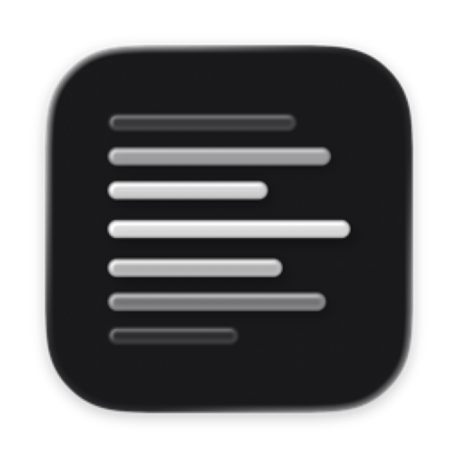
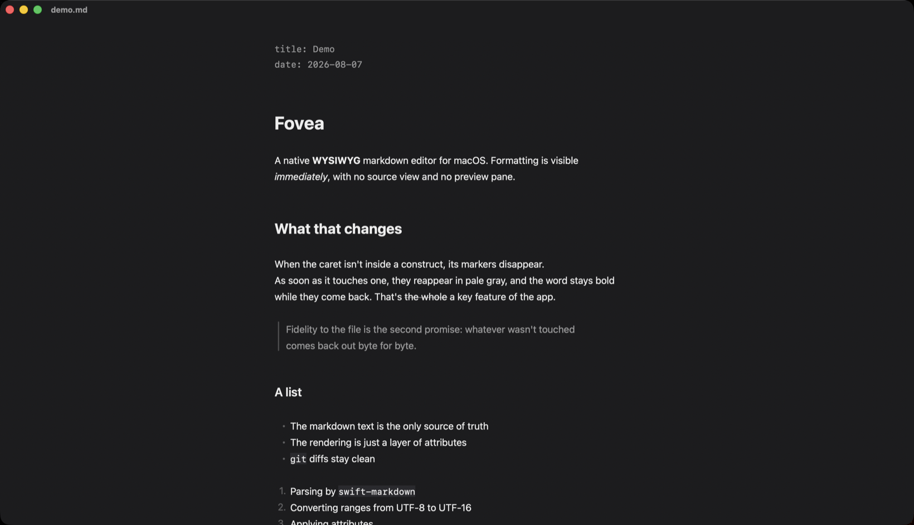

<div align="center">



# Fovea

**Formatting is visible immediately.**

A native macOS markdown reader you can also write in — no code view, no preview pane.

[](#system-requirements)
[](#system-requirements)
[](#how-it-works)
[](#test)
[](LICENSE)

<!-- Enable once the first release is published:
[](https://github.com/eliorpom-cmd/fovea/releases/latest)
[](https://github.com/eliorpom-cmd/fovea/releases)
-->



</div>

---

## What is Fovea?

The name comes from the *fovea centralis*, the area of the retina where vision
is sharpest. That's the app's whole program: bring the text into focus and let
everything else disappear.

You double-click a `.md` in the Finder. It opens instantly, rendered. You read
it, fix a line, close it. That's the whole job — Fovea is the tool you reach
for **for forty seconds**, the one that makes a markdown file behave like a
document instead of a wall of asterisks.

**It is not where you keep your notes.** Obsidian is very good at that, and
Fovea doesn't compete: no vault, no graph, no backlinks, no plugins, and it
will never ask you to open a folder. It opens a file. If you're writing at
length, write in Obsidian. If you just need to read or fix one file, this opens
faster than anything with a vault to load.

## The two promises

### Formatting is visible

Markdown markers are invisible by default and reappear, in pale gray, as soon
as the caret touches the construct they belong to. The word stays bold while
its `**` come back.

A `#`, `>` or line-start `-`, though, waits for the caret to reach the start of
the line. Without that, moving down through a document would make every heading
and list item you pass through flash — the rule that reads simplest turned out
to be the most unpleasant to use.

### The file doesn't move

Whatever you haven't touched comes back **byte for byte**. `*` never becomes
`_`, list indentation is never recalculated, a Windows file's line endings stay
as they are. Your `git diff` only contains what you actually wrote.

This isn't a matter of discipline. The app never writes from a syntax tree, so
it is **structurally incapable** of reformatting anything you haven't edited.

## Highlights

### It reads everything

Headings — closed by a hairline at levels 1 and 2, like every preview draws
them — bold, italic, strikethrough, inline code, links, blockquotes, bulleted
and numbered lists, task lists, horizontal rules, code blocks with syntax
highlighting for eleven languages, YAML front matter, footnotes, inline
images, and tables as a grid that keeps the alignment its `|:--|--:|` row
declares. All six heading levels render; the menu offers the first three,
which are the ones that differ in size.

Links are followed on `⌘`-click, wherever they lead: an address to the
browser, `[the licence](LICENSE)` to the file next to the document,
`[contents](#highlights)` to that heading in the page. An address written
bare is a link too.

### It writes the simple things

Type the markers and they fold away as soon as the caret leaves. `⏎` continues
a list and exits it on an empty item, `⇥`/`⇧⇥` change the level,
`⌘B`/`⌘I`/`⌘⇧X`/`⌘⇧K` wrap or remove formatting, `⌘⌃0..3` change the heading
level, `⌘K` inserts a link from the pasteboard. Clicking a checkbox checks it —
`⌘⏎` from the keyboard. `(` closes itself, and `⇥` steps out of the pair.

### `⌥⌘S` is the safety net

It shows the raw markdown. For anything more elaborate than the list above —
restructuring a table, writing a long document — that's the way through: put
the caret in a table and its `|` come back, to be edited as the plain text they
are.

### It behaves like a Mac app

Opening, saving, tabs, Open Recent, Time Machine versions, session restoration
and iCloud Drive all come from `NSDocument` — none of it is reimplemented.
`⌘F` uses the native find bar, spell checking is the system's. `⌘V` converts
rich text pasted from a browser into markdown, `⌘⇧V` pastes plain. It installs
itself as the system's default Markdown editor, and reopens a document where
you stopped reading it.

Four settings, and no window for them: appearance, body font, code font and
`⌘+`/`⌘−`, in the View menu. The fonts open the system font panel.

## What it deliberately doesn't do

No export, no PDF, no printing, no share sheet. No vault, no tags, no
backlinks, no plugins. No focus mode, no typewriter mode, no word count. No
font importing. No command palette, no insertion menu, no panels of any kind.
No editing inside the table grid — the source is right there under the caret,
and a table the parser refuses is shown in the fixed-pitch font so its columns
still line up.

**Each of these existed at some point and was removed.** They come back one at
a time if enough people ask, and not before: the app that opens in two seconds
is the app that has little to load. If you want one of them back, the
[scope policy](CONTRIBUTING.md) explains how to make the case.

## What's not there yet

**VoiceOver still reads the hidden syntax.** The semantic roles exist and
interface elements carry them, but the text buffer itself is read as-is: macOS
doesn't consult the string's attributes for accessibility. The detail, and why
the obvious workaround is worse than the problem, is in
[§8 of the design principles](docs/PRINCIPLES.md#8-accessibility).

Also missing: **notarization**, which requires a paid developer account, and a
**built-in updater**.

## Install

```bash
scripts/install.sh
```

Builds in Release, installs into `/Applications`, registers the app with
LaunchServices and launches it. On first launch, macOS warns that it isn't
notarized — right-click the app → **Open**, once.

Fovea then offers to become the default Markdown editor: `.md`, `.markdown`
and `.mdown` files will open with a double-click. The option stays available in
the Fovea menu.

## System requirements

| | |
| --- | --- |
| **macOS** | 15 Sequoia or later |
| **Chip** | Apple Silicon (arm64) — no Intel build |
| **Disk** | 1.9 MB |
| **Memory** | ~30 MB with a document open |
| **Network** | None. Ever. |
| **Account** | None. Ever. |

355 ms from double-click to a window on an M1 Pro, where TextEdit takes 400 ms
opening the same file.

## How it works

`NSDocument` → one `NSTextView` on **TextKit 2** holding the markdown source →
[swift-markdown](https://github.com/apple/swift-markdown) parses the touched
block → the ranges it returns become style attributes and zero-width masks laid
*over* the same buffer.

There is only ever one string. Rendering is a layer of attributes, never a
transformation, which is what makes the fidelity promise structural rather than
careful.

- **`Markdown/`** imports no AppKit, so the range conversion — UTF-8 bytes to
  UTF-16 units, the pitfall that misaligns every attribute from the first
  accented letter onward — is tested without launching an interface.
- **No highlighting dependency.** The syntax colouring is homegrown rules over
  a closed set of languages: not Highlightr, which bundles JavaScriptCore, and
  not tree-sitter, which means compiling C grammars.
- **Project file generated** by XcodeGen from `project.yml`, which is the
  source of truth — `.xcodeproj` is gitignored.

[docs/ARCHITECTURE.md](docs/ARCHITECTURE.md) goes further, including the dead
ends that were avoided.

## Build

```bash
brew install xcodegen
xcodegen generate
xcodebuild -project Fovea.xcodeproj -scheme Fovea -configuration Release build
```

## Test

```bash
xcodebuild -project Fovea.xcodeproj -scheme Fovea -destination 'platform=macOS' test
```

248 tests, including the performance budgets, which **fail** if they're
exceeded: 8 ms per keystroke at 10,000 words, 16 ms at 100,000, 500 ms to first
display. They run in Debug, the least favorable configuration.

To check file fidelity on real documents:

```bash
scripts/fidelity-check.sh my-document.md
```

The script opens each file in the app, saves it without touching it, and judges
the result on a `git diff`.

## Documentation

| Document | What's in it |
| --- | --- |
| [docs/PRINCIPLES.md](docs/PRINCIPLES.md) | The rules the code answers to. The `§n` references throughout the sources point here |
| [docs/ARCHITECTURE.md](docs/ARCHITECTURE.md) | Why the code is built this way, and the dead ends avoided |
| [docs/BUILDING.md](docs/BUILDING.md) | Building, testing, signing, troubleshooting |
| [design/README.md](design/README.md) | The icon: its Icon Composer source, and why a rendered `.icns` ships instead |
| [CONTRIBUTING.md](CONTRIBUTING.md) | The scope policy, and how to propose a change |
| [SECURITY.md](SECURITY.md) | Reporting a vulnerability |
| [CHANGELOG.md](CHANGELOG.md) | Notable changes per version |

## License

**[GPL-3.0](LICENSE)** for this project's own source. In plain terms:

- **Fork it, change it, use it** — for anything, including at work. No
  permission needed.
- **Ship your fork and you ship your source too**, under the same license.
- **Credit stays legible** — keep the [NOTICE](NOTICE) file, and name the
  original in your own about screen.
- **The icon isn't yours to reuse.** It is the author's own work, licensed to
  this app only; a fork ships its own.

Copyright stays with the author, so other arrangements are possible: if the GPL
doesn't fit your use, ask.

Fovea depends on [swift-markdown](https://github.com/apple/swift-markdown)
(Apache-2.0). Everything else is macOS. See [NOTICE](NOTICE).

## Credits

Built by [Elior Pommier](https://byelior.com).

- **[swift-markdown](https://github.com/apple/swift-markdown)** gives the
  CommonMark/GFM tree with a source range on every node. Fovea never
  re-serializes it — it only uses it to know *where* to set attributes.
- **TextKit 2** does the layout by viewport, which is the only reason a
  100,000-word document opens in under half a second.

<div align="center">

<sub>The app disappears. That's the point.</sub>

</div>
